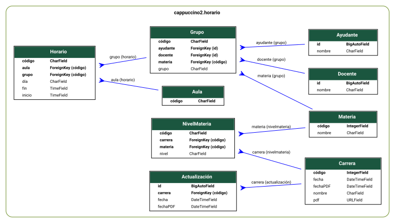
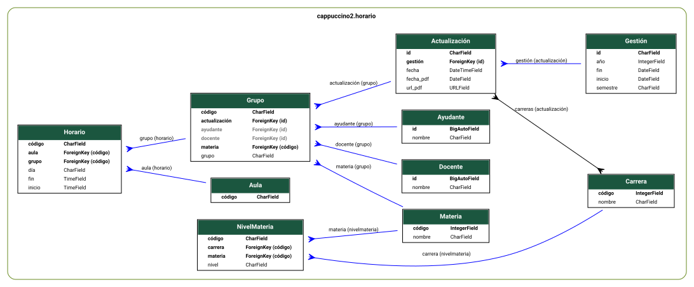
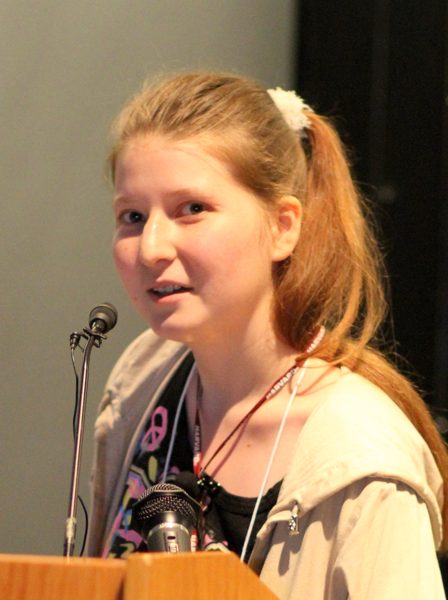
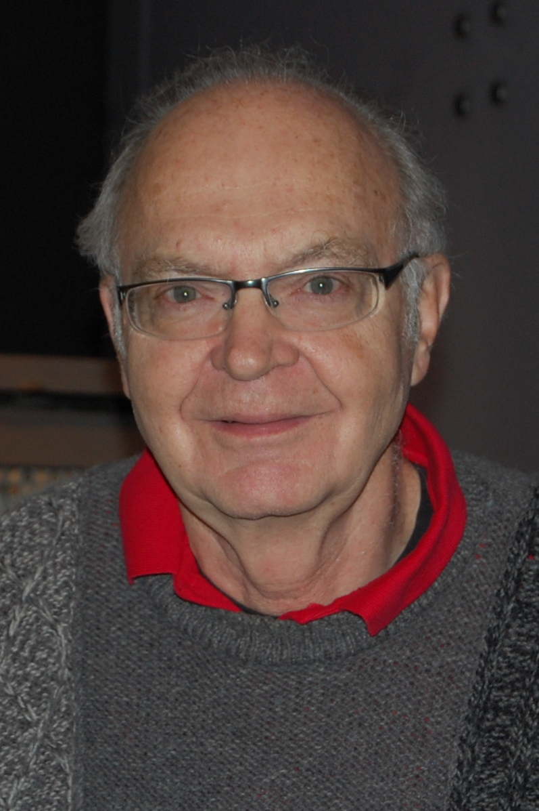

:title: Arquitectura de Software
:author: Daniel Saguez Tezanos Pinto
:description: Actualizar conceptos de Aquitectura de Software
:keywords: presentación, restructuredtext, impress.js, REST, C++
:data-transition-duration: 1500
:auto-console: false
:skip-help: true
:slide-numbers: true
:css: css/presenta.css

.. header::
   .. image:: Imágenes/MARCA-UAB-UAB.png
            :width: 12%
            :align: left

.. title: Arquitectura de Software

----

:hovercraft-path: M 63.28,46.17 C 58.50,44.22 60.29,37.17 63.89,34.88 70.40,30.23 79.91,34.47 82.97,41.31 88.12,51.87 80.91,65.13 70.15,68.59 56.83,73.39 41.21,65.15 36.21,52.22 29.43,36.29 37.93,16.62 53.10,9.03 67.66,1.18 86.49,4.48 98.72,15.18 111.92,26.24 117.09,45.23 112.53,61.67 108.14,79.09 94.02,93.57 76.69,98.34 c -3.36,0.98 -6.83,1.641 -10.32,1.96
:data-perspective: 500
:data-z: r-500
:id: inicio

########################
Arquitectura de Software
########################

.. class:: substep

La arquitectura de software de un sistema es el conjunto de estructuras necesarias para razonar sobre el sistema. Estas estructuras comprenden elementos de software, relaciones entre ellos y propiedades de ambos. *Software Architecture in Practice (4th Edition)*

----

La arquitectura de software se refiere a la estructuración de alto nivel de un sistema de software, lo que implica tomar decisiones de diseño clave para garantizar que los componentes del sistema funcionen de manera cohesiva para cumplir con los requisitos especificados.

*Fundamentals of Software Architecture (2025)*

----

La arquitectura de software es lo que resulta difícil de cambiar más adelante.

*Software Architecture: The Hard Parts (2021)*

----

La arquitectura de un sistema es un puente entre los objetivos de negocio abstractos y el sistema concreto resultante, fuertemente influenciada por la Ley de Conway ("la arquitectura de un sistema tiende a reflejar la estructura de comunicación de la organización que lo construye").

Software Architecture with C++ (2nd Edition, 2025)

----

:id: dstp

La arquitectura de software se define como el conjunto de habilidades y técnicas que permiten identificar aquellos elementos de mayor relevancia en el momento preciso en que son requeridos.

DsTp

----

Arquitectura vs Diseño
----------------------

    * Diseño de software: implementación detallada (algoritmos, estructuras de datos).
    * Línea divisoria: ¿“cuándo termina la arquitectura y comienza el diseño”?

----

Diagrama ER como herramienta para entender sistemas
---------------------------------------------------

    * ¿Qué hace un sistema?: identificar entidades, relaciones y cardinalidades.
    * Ejemplo: diagrama `ER <https://es.wikipedia.org/wiki/Modelo_entidad-relaci%C3%B3n>`_ de caso real (esquema de base de datos).
    * Interpretación: cómo leer qué hace el sistema desde un `ER <https://es.wikipedia.org/wiki/Modelo_entidad-relaci%C3%B3n>`_.

----

Es sumamente significativo que la principal ventaja del `modelo relacional <https://es.wikipedia.org/wiki/%C3%81lgebra_relacional>`_, la
posibilidad de realizar consultas ad hoc estuviera fuera del alcance del modelo
“relacional” más popular a lo largo de los ochenta: `dBase <https://es.wikipedia.org/wiki/DBase>`_, y sus secuelas `Clipper <https://es.wikipedia.org/wiki/Clipper_(lenguaje_de_programaci%C3%B3n)>`_ y `FoxPro <https://es.wikipedia.org/wiki/FoxPro_2>`_.
Cuando escucho elogios sobre Clipper por parte de programadores que hicieron
carrera con este lenguaje, pienso con tristeza que los elogios los merecen los propios
programadores que pudieron realizar software funcional con herramientas tan primitivas.

Mi aplauso para ellos; en ningún caso para el lenguaje. Y mi consejo de que
abandonen el viejo buque (y las malas costumbres aprendidas durante la travesía)
antes de que termine de hundirse.

----

Y a todas estas, ¿qué pasó con la mascota de `Mr. Codd <https://es.wikipedia.org/wiki/Edgar_Frank_Codd>`_? Lo inevitable: murió como
consecuencia de un experimento fallido. Sin embargo, Brahma se apiadó de él, y
reencarnó al año en un chico que, con el tiempo, se ha convertido en un exitoso
programador afincado en el sur de la Florida. Al verlo, nadie pensaría que fue un perro
en su vida anterior, de no ser por la manía que tiene de rascarse periódicamente la
oreja. No obstante, por haber destrozado la tapicería del sofá de su dueño y orinarse
un par de veces en la alfombra del salón, fue condenado a programar dos largos años
en `Visual Basic <https://es.wikipedia.org/wiki/Visual_Basic>`_, hasta que `C++ Builder <https://es.wikipedia.org/wiki/C%2B%2BBuilder>`_ (¿o fue `Delphi <https://es.wikipedia.org/wiki/Embarcadero_Delphi>`_?) llegó a su vida y se convirtió
en un hombre feliz.

`La Cara Oculta de C++ Builder, Ian Marteens <https://elhacker.info/manuales/Lenguajes%20de%20Programacion/C%2B%2B/La%20cara%20oculta%20de%20C++%20Builder.pdf>`_

----

----

----

UML – Lenguaje unificado de modelado
----------------------------------------

* `UML <https://es.wikipedia.org/wiki/Lenguaje_unificado_de_modelado>`_: lenguaje de modelado de sistemas de `software <https://es.wikipedia.org/wiki/Software>`_ más conocido y utilizado en la actualidad, respaldado por el `Object Management Group <https://es.wikipedia.org/wiki/Object_Management_Group>`_ (OMG)

----

ISO/IEC 42010 — Systems and software engineering — Architecture description
----------------------------------------------------------------------------

:id: iso

* Estándar internacional para la descripción de la arquitectura de sistemas y productos software.
* Empezo como `ANSI/IEEE 1471-2000, Recommended Practice for Architecture Description of Software-Intensive Systems. <https://en.wikipedia.org/wiki/IEEE_1471>`_

----

ISO/IEC 42010
-------------

:id: ISO42010_1

* Arquitectura (proceso): (architecting). Proceso de concebir, expresar, documentar, comunicar, certificar la implementación, mantener y mejorar la arquitectura a través de todo el ciclo de vida de un sistema
* Arquitectura: Conceptos fundamentales o propiedades de un sistema en un entorno definido, encarnado en elementos, las relaciones que existen entre ellos; y los principios que guían su diseño y evolución.
* Descripción de la arquitectura (abreviación 'AD'): Artefacto utilizado para describir una arquitectura

----

:id: ISO42010_2

ISO/IEC 42010
-------------

* Lenguaje para la Descripción de Arquitectura ('ADL'): Cualquier expresión que pueda ser utilizada en la descripción de arquitecturas.
* Marco de trabajo de arquitectura: convenciones, principios y prácticas para la descripción de arquitecturas; establecidos dentro de un dominio específico de aplicación o dentro de una comunidad de interesados.

----

:id: ISO42010_3

ISO/IEC 42010
-------------

* Punto de vista de la arquitectura: Producto de trabajo que establece las convenciones para la construcción, interpretación y uso de vistas de la arquitectura con el objetivo de abarcar asuntos y aspectos específicos del sistema.
* Vista de la arquitectura: Producto de trabajo que muestra la arquitectura de un sistema conforme a la perspectiva de un conjunto de asuntos y aspectos del sistema.

----

Decisiones arquitectónicas clave: licencia, BD, lenguaje, frameworks
--------------------------------------------------------------------

* Selección de licencia: open-source (`MIT <https://es.wikipedia.org/wiki/Licencia_MIT>`_, `GPL <https://es.wikipedia.org/wiki/GNU_General_Public_License>`_, `BSB <https://es.wikipedia.org/wiki/Licencia_BSD>`_...), implicaciones.
* Tipo de BD: `SQL <https://es.wikipedia.org/wiki/SQL>`_ vs `NoSQL <https://es.wikipedia.org/wiki/NoSQL>`_, consistencia, escalabilidad.
* Lenguaje y frameworks: ejemplos y criterios de elección.
* Buenas practicas, herramientas de análisis estático y dinámico de código.
* ¿Dónde encajan estas decisiones? ¿En la **arquitectura**? ¿Capas macro?.

----

Portabilidad
------------

.. class:: substep

* `Doom <https://es.wikipedia.org/wiki/Doom_(videojuego_de_1993)>`_
* **La saga Quake (Quake, Quake II y Quake III Arena)**:
  Diseñados también por `id Software <https://es.wikipedia.org/wiki/Id_Software>`_
  bajo la dirección técnica de `John Carmack <https://es.wikipedia.org/wiki/John_Carmack>`_,
  estos motores gráficos siguieron la misma filosofía de portabilidad y optimización
  que Doom. Fueron programados originalmente en
  `lenguaje C <https://es.wikipedia.org/wiki/C_(lenguaje_de_programaci%C3%B3n)>`_,
  lo que facilitó su posterior liberación bajo la Licencia Pública General de GNU
  (`GPL <https://es.wikipedia.org/wiki/GNU_General_Public_License>`_). Al igual que Doom,
  su código limpio y estructurado ha permitido el desarrollo de puertos independientes
  a decenas de plataformas de hardware modernas y retro.

----

Sistemas Operativos Completos
-----------------------------

* **NetBSD**:
  Un `sistema operativo <https://es.wikipedia.org/wiki/Sistema_operativo>`_
  libre de la familia Unix conocido por su enfoque en la portabilidad extrema y
  su célebre lema *"Por supuesto que ejecuta NetBSD"* (*Of course it runs NetBSD*).
  Está diseñado con una separación extremadamente rigurosa entre el código
  independiente de la máquina y las capas de abstracción de hardware, lo que le
  permite ejecutarse de forma nativa en más de 50
  `arquitecturas de CPU <https://es.wikipedia.org/wiki/Arquitectura_de_computadoras>`_
  distintas (desde supercomputadoras y servidores corporativos hasta pequeños sistemas integrados).

----

Sistemas de Bases de Datos 
---------------------------

* **SQLite**:
  Una biblioteca de `base de datos <https://es.wikipedia.org/wiki/Base_de_datos>`_
  relacional escrita en
  `lenguaje C <https://es.wikipedia.org/wiki/C_(lenguaje_de_programaci%C3%B3n)>`_
  que es completamente autónoma, de
  `dominio público <https://es.wikipedia.org/wiki/Dominio_p%C3%BAblico>`_ y libre de
  dependencias externas. Al requerir una sobrecarga de tiempo de ejecución prácticamente
  nula, `SQLite <https://es.wikipedia.org/wiki/SQLite>`_ se integra de manera idéntica en
  `teléfonos inteligentes <https://es.wikipedia.org/wiki/Tel%C3%A9fono_inteligente>`_
  (iOS y Android), navegadores web (mediante WebAssembly), sistemas de aviónica, automoción
  y miles de `sistemas embebidos <https://es.wikipedia.org/wiki/Sistema_embebido>`_.

----

Máquinas Virtuales
--------------------

* **Máquina Z (Z-machine) e Infocom**:
  La `Máquina Z <https://es.wikipedia.org/wiki/M%C3%A1quina_Z>`_ es una
  `máquina virtual <https://es.wikipedia.org/wiki/M%C3%A1quina_virtual>`_ creada
  en 1979 por la compañía Infocom para ejecutar sus videojuegos de aventuras
  conversacionales de texto (como el clásico
  `Zork <https://es.wikipedia.org/wiki/Zork>`_). En lugar de reescribir cada juego
  para la plétora de microordenadores incompatibles de la época, Infocom escribía el
  juego una sola vez en un formato de instrucciones estandarizado e implementaba un
  pequeño
  `intérprete <https://es.wikipedia.org/wiki/Int%C3%A9rprete_(inform%C3%A1tica)>`_
  específico para cada hardware, logrando una portabilidad sin precedentes en su era.

----

Utilidades y Bibliotecas Estándar de la Industria
-------------------------------------------------

* **VLC media player**:
  Un reproductor y armazón multimedia multiplataforma de
  `código abierto <https://es.wikipedia.org/wiki/C%C3%B3digo_abierto>`_ diseñado en
  C/C++ altamente portable. Su modularidad le permite decodificar de forma interna
  casi cualquier formato de video o audio en prácticamente cualquier sistema de
  escritorio o móvil sin requerir la instalación de códecs externos del sistema operativo.

----

* **BusyBox**:
  Conocido como *"la navaja suiza de Linux embebido"*,
  `BusyBox <https://es.wikipedia.org/wiki/BusyBox>`_ combina versiones compactas de
  múltiples utilidades estándar de `Unix <https://es.wikipedia.org/wiki/Unix>`_ en un
  único y pequeño binario ejecutable. Su diseño optimizado en C portable lo convierte en
  un componente esencial para sistemas empotrados con recursos de almacenamiento y memoria
  severamente limitados.

* **zlib y libpng**:
  Bibliotecas fundamentales escritas en C de alta portabilidad destinadas a la compresión
  de datos bajo el algoritmo Deflate (`zlib <https://es.wikipedia.org/wiki/Zlib>`_) y a
  la manipulación de imágenes en formato PNG (`libpng <https://es.wikipedia.org/wiki/Libpng>`_).
  Prácticamente todos los navegadores web, suites de oficina y motores gráficos modernos
  incorporan o dependen directamente de estas dos bibliotecas en sus capas inferiores.

----

Doom 1993
---------

:id: doom

Oficialmente, `id Software <https://es.wikipedia.org/wiki/Id_Software>`_ 
lanzó el videojuego `Doom <https://es.wikipedia.org/wiki/Doom_(videojuego_de_1993)>`_ 
original para `MS-DOS <https://es.wikipedia.org/wiki/MS-DOS>`_ en diciembre de 1993.
Durante la década de 1990, el motor fue adaptado oficialmente a aproximadamente
entre 10 y 12 plataformas comerciales, que incluyen:

----

:id: doom-consolas

* **Consolas y Computadores Personales de los 90**:

  * `Classic Mac OS <https://es.wikipedia.org/wiki/Classic_Mac_OS>`_
  * `Sega 32X <https://es.wikipedia.org/wiki/Sega_32X>`_
  * `Atari Jaguar <https://es.wikipedia.org/wiki/Atari_Jaguar>`_
  * `Super Nintendo Entertainment System (SNES) <https://es.wikipedia.org/wiki/Super_Nintendo_Entertainment_System>`_
  * `PlayStation <https://es.wikipedia.org/wiki/PlayStation_(consola)>`_
  * `Sega Saturn <https://es.wikipedia.org/wiki/Sega_Saturn>`_
  * `3DO Interactive Multiplayer <https://es.wikipedia.org/wiki/3DO>`_
  * `Game Boy Advance <https://es.wikipedia.org/wiki/Game_Boy_Advance>`_
  * `PC-98 <https://es.wikipedia.org/wiki/PC-98>`_
  * `NeXTSTEP <https://es.wikipedia.org/wiki/NeXTSTEP>`_ (utilizada como la plataforma de desarrollo original del motor gráfico.
  * `OS/2 <https://es.wikipedia.org/wiki/OS/2>`_ [14] e `IRIX <https://es.wikipedia.org/wiki/IRIX>`_ de Silicon Graphics.

----

Lanzamientos No Oficiales (Comunidad de Código Abierto)
-------------------------------------------------------

Tras la liberación del `código fuente <https://es.wikipedia.org/wiki/C%C3%B3digo_fuente>`_ de Doom en 1997 bajo una licencia no comercial [15, 16] y su posterior re-licenciamiento libre bajo la Licencia Pública General de GNU (`GPL <https://es.wikipedia.org/wiki/GNU_General_Public_License>`_) en 1999 [15, 16], la comunidad de desarrolladores independientes ha portado el motor a **más de 100 plataformas y dispositivos** [4, 15], originando el famoso meme de internet *"¿Puede ejecutar Doom?"* [15].

----

* **Sistemas Operativos de Escritorio, Servidores y Estaciones de Trabajo**:

  * `Microsoft Windows <https://es.wikipedia.org/wiki/Microsoft_Windows>`_ [6, 17]
  * `Linux <https://es.wikipedia.org/wiki/Linux>`_ (el primer port fue desarrollado por el programador Dave Taylor en 1994 de forma semi-oficial [16, 18])
  * `AmigaOS <https://es.wikipedia.org/wiki/AmigaOS>`_ (mediante ports de la comunidad como ADoom [19])
  * `RISC OS <https://es.wikipedia.org/wiki/RISC_OS>`_ [6, 7]
  * `Solaris <https://es.wikipedia.org/wiki/Solaris_(sistema_operativo)>`_ [5]
  * `BeOS <https://es.wikipedia.org/wiki/BeOS>`_
  * `FreeBSD <https://es.wikipedia.org/wiki/FreeBSD>`_ [15]

----

* **Plataformas Móviles, Portátiles y Entornos Web**:

  * `Android <https://es.wikipedia.org/wiki/Android>`_ [6, 20]
  * `iOS <https://es.wikipedia.org/wiki/IOS>`_ (con adaptaciones oficiales tempranas como "Doom Classic", basadas en el port `PrBoom <https://en.wikipedia.org/wiki/PrBoom>`_ [21])
  * Navegadores web que ejecutan el motor a través de `HTML5 <https://es.wikipedia.org/wiki/HTML5>`_ (como el port "boon" mediante `Emscripten <https://es.wikipedia.org/wiki/Emscripten>`_) [22] o código nativo compilado directamente a `WebAssembly <https://es.wikipedia.org/wiki/WebAssembly>`_ [22]

----

* **Dispositivos Integrados, Sistemas Domésticos y Curiosidades Exóticas**:

  * `Raspberry Pi <https://es.wikipedia.org/wiki/Raspberry_Pi>`_ (incluyendo un port completo y optimizado para la placa de microcontrolador `Raspberry Pi Pico <https://en.wikipedia.org/wiki/Raspberry_Pi_Pico>`_ basada en el chip RP2040 [2])
  * `Cajeros automáticos <https://es.wikipedia.org/wiki/Cajero_autom%C3%A1tico>`_ [15]
  * `Impresoras <https://es.wikipedia.org/wiki/Impresora>`_ [15]
  * `Pianos <https://es.wikipedia.org/wiki/Piano>`_ [15]
  * `Termostatos <https://es.wikipedia.org/wiki/Termostato>`_ domésticos inteligentes (como el Honeywell Prestige [23])

----
 
  * Cámaras digitales con `Digita OS <https://en.wikipedia.org/wiki/DigitaOS>`_ [19]
  * Calculadoras gráficas (como la serie `TI-Nspire <https://es.wikipedia.org/wiki/TI-Nspire>`_ mediante nDoom [24])
  * Cortadoras de césped robóticas (como la Husqvarna Automower NERA [25])
  * Adaptadores de hardware embebido (como el chip controlador del adaptador Apple Lightning a HDMI [26])
  * Ejecutado mediante emulación dentro de otros mundos virtuales (como `Minecraft <https://es.wikipedia.org/wiki/Minecraft>`_) o en pantallas interactivas de otros videojuegos (como Doom 3 mediante el mod "Terminal Doom" [27])

----

Arquitecturas de CPU Soportadas
-------------------------------

Las adaptaciones de la comunidad y oficiales de Doom abarcan decenas de familias de microprocesadores, entre las que destacan:

* `x86 <https://es.wikipedia.org/wiki/X86>`_ (arquitecturas de 16 bits, 32 bits y 64 bits en sistemas DOS, Windows, etc.) [1, 28]
* `ARM <https://es.wikipedia.org/wiki/Arquitectura_ARM>`_ (arquitectura base utilizada en RISC OS, Raspberry Pi Pico y dispositivos móviles modernos) [2, 7]
* `PowerPC <https://es.wikipedia.org/wiki/PowerPC>`_ (para arquitecturas Classic Mac OS heredadas) [5]
* `PA-RISC <https://es.wikipedia.org/wiki/PA-RISC>`_ (para analizadores lógicos de Hewlett-Packard ejecutando HP-UX [27])

----

* `Motorola 68000 <https://es.wikipedia.org/wiki/Motorola_68000>`_ (para computadores Macintosh con procesadores 68040) [5]
* `MIPS <https://es.wikipedia.org/wiki/Arquitectura_MIPS>`_
* `RISC-V <https://es.wikipedia.org/wiki/RISC-V>`_
* `SuperH <https://es.wikipedia.org/wiki/SuperH>`_

----

Qué se necesita para la Portabilidad Extrema
--------------------------------------------

Al igual que ocurre con el motor de Doom, el secreto detrás de la extrema portabilidad
de estas herramientas de software radica en tres principios arquitectónicos de bajo
nivel:

#. **La elección del lenguaje**: El uso de C o C++ estructurado garantiza la
   disponibilidad de compiladores nativos en prácticamente cualquier plataforma
   física existente.

----

#. **Ausencia de un entorno de ejecución pesado (Heavy Runtime)**: La omisión de
   recolectores de basura dinámicos o máquinas virtuales masivas permite que el
   ejecutable tenga un control directo y predecible de la memoria física.

----

#. **Modularidad rigurosa**: Una separación estricta entre la lógica de ejecución del
   programa y las capas de entrada/salida de bajo nivel del sistema de destino.

----

¿Por qué el lenguaje C hizo que Doom fuera tan portátil?
--------------------------------------------------------

El uso del `lenguaje C <https://es.wikipedia.org/wiki/C_(lenguaje_de_programaci%C3%B3n)>_`
como base para programar `Doom <https://es.wikipedia.org/wiki/Doom_(videojuego_de_1993)>`_
fue un factor fundamental para su posterior expansión, aunque no explica la historia completa.

C actuó como el cimiento técnico ideal debido a sus características de bajo nivel, pero fue
la combinación con una arquitectura interna limpia lo que garantizó su adaptabilidad.

----

1. Ubicuidad global del lenguaje y sus compiladores
---------------------------------------------------

La presencia de un `compilador <https://es.wikipedia.org/wiki/Compilador>`_ de C
es prácticamente universal en la informática. Desde modestos `microcontroladores
<https://es.wikipedia.org/wiki/Microcontrolador>`_ de 8 bits hasta complejas
`supercomputadoras <https://es.wikipedia.org/wiki/Supercomputadora>`_ de investigación,
casi cualquier arquitectura de hardware cuenta con herramientas nativas para traducir código
en C. Esto simplificó la adaptación del código original (desarrollado en estaciones de trabajo
`NeXTSTEP <https://es.wikipedia.org/wiki/NeXTSTEP>`_) a una gran diversidad de sistemas.

----

2. Ausencia de un entorno de ejecución pesado (*Heavy Runtime*)
---------------------------------------------------------------

A diferencia de otros lenguajes de alto nivel, C no requiere un
`recolector de basura <https://es.wikipedia.org/wiki/Recolector_de_basura>`_ dinámico, un
entorno de ejecución persistente, una
`máquina virtual <https://es.wikipedia.org/wiki/M%C3%A1quina_virtual>`_ o una
`biblioteca de tiempo de ejecución <https://es.wikipedia.org/wiki/Biblioteca_de_tiempo_de_ejecuci%C3%B3n>`_
sobredimensionada. C genera `código nativo <https://es.wikipedia.org/wiki/C%C3%B3digo_objeto>`_
directo y predecible. Esto reduce al mínimo la huella de memoria del binario ejecutable y permite que el
motor se ejecute en dispositivos con severas restricciones de hardware y de
`gestión de memoria <https://es.wikipedia.org/wiki/Gesti%C3%B3n_de_memoria>`_.

----

3. Control de bajo nivel con expresividad de alto nivel
-------------------------------------------------------

C combina la abstracción estructurada para escribir la compleja lógica del juego de manera limpia (como
la inteligencia artificial de los monstruos, la generación de mapas y el subsistema de colisiones) con la
capacidad de realizar manipulación de memoria de bajo nivel cuando es necesario (mediante punteros y acceso
directo a registros de hardware). Esto permitió a id Software optimizar manualmente las funciones críticas
de renderizado sin necesidad de escribir todo el juego en
`lenguaje ensamblador <https://es.wikipedia.org/wiki/Lenguaje_ensamblador>`_.

----

C como condición necesaria pero no suficiente
---------------------------------------------

Un programa escrito en C que esté mal diseñado, que abuse de dependencias globales acopladas o que esté mal
estructurado puede ser extremadamente difícil de portar. La portabilidad real de Doom no radicó únicamente
en el lenguaje C, sino en decisiones de diseño sumamente estrictas tomadas por sus creadores:

----

* **Estructura rígida y modularidad de subsistemas**: El motor de Doom implementa una rigurosa visibilidad
  estática y una separación explícita de subsistemas. Toda la lógica del juego está aislada de la capa
  del sistema operativo, facilitando que el portador solo deba concentrarse en reescribir pequeñas capas de
  abstracción para la pantalla, el sonido o el teclado.

----

* **Renderizado por software puro**: Al proyectar toda su geometría 2.5D en un búfer de pantalla plano en la
  memoria física (`framebuffer <https://es.wikipedia.org/wiki/B%C3%BAfer_de_la_estructura_de_la_pantalla>`_),
  el juego no requirió de ninguna API gráfica de hardware propietaria. Cualquier máquina que pudiese pintar
  píxeles en una pantalla podía ejecutar los gráficos de Doom de manera fluida.

----

* **Independencia absoluta de datos mediante archivos WAD**: El motor separa físicamente el código ejecutable
  de los activos artísticos (niveles, texturas, sprites y música) empaquetados en archivos
  `WAD <https://es.wikipedia.org/wiki/Doom_WAD>`_. Esto impidió que las modificaciones o ports tuviesen que
  recompilar recursos gráficos dentro del binario del motor.

----

En resumen: **C proporcionó los cimientos técnicos óptimos, pero las decisiones de diseño arquitectónico de
id Software convirtieron esa portabilidad teórica en una realidad práctica.**

----

¿Existe un equivalente en Java: software tan portátil como Doom pero escrito en Java?
-------------------------------------------------------------------------------------

----

La respuesta corta es **no en el mismo sentido físico o extremo**. Aunque
`Java <https://es.wikipedia.org/wiki/Java_(lenguaje_de_programaci%C3%B3n)>`_ es famoso por su filosofía de
portabilidad *"Escríbelo una vez, ejecútalo en cualquier lugar"* (*Write Once, Run Anywhere*), su modelo
de ejecución difiere radicalmente de la portabilidad nativa de `C` o `C++`.

----

1. El Modelo de Portabilidad: Compilación Nativa vs. Bytecode
-------------------------------------------------------------

La diferencia fundamental entre la portabilidad de `Doom` y la de un programa en `Java` radica en dónde
se realiza el trabajo de adaptación:

----

**La portabilidad de Doom (C/C++)**: Se basa en la **portabilidad del código fuente**. Cada arquitectura
de hardware de destino compila el código fuente nativamente utilizando un
`compilador <https://es.wikipedia.org/wiki/Compilador>`_ específico para su conjunto de instrucciones físicas
(por ejemplo, x86, ARM o MIPS). No hay intermediarios en tiempo de ejecución.

----

**La portabilidad de Java**: Se basa en la **portabilidad a nivel binario** mediante
`bytecode <https://es.wikipedia.org/wiki/Bytecode>`_. El programador compila el código una sola vez a un
formato intermedio estandarizado. Este archivo binario (`.class` o `.jar`) puede ser ejecutado de forma
idéntica en cualquier hardware, siempre y cuando dicho sistema disponga de una
`Máquina virtual Java <https://es.wikipedia.org/wiki/M%C3%A1quina_virtual_Java>`_ (JVM) previamente
instalada y adaptada para ese procesador.

----

2. El cuello de botella de la JVM en hardware exótico
-----------------------------------------------------

El modelo de Java requiere que la plataforma de destino aloje la JVM completa, la cual incluye un
recolector de basura dinámico, carga de clases en tiempo de ejecución, y un compilador justo a tiempo
(JIT) o un intérprete de bytecode pesado. 

Esto crea una dependencia masiva que impide que Java se ejecute en los dispositivos de recursos
extremadamente limitados donde `Doom` sí ha sido adaptado con éxito de forma nativa:

Dispositivos exóticos como `calculadoras gráficas <https://es.wikipedia.org/wiki/Calculadora_gr%C3%A1fica>`_
(por ejemplo, la TI-Nspire), `impresoras <https://es.wikipedia.org/wiki/Impresora>`_,
osciloscopios o microcontroladores de bajísimo costo carecen de la
`memoria RAM <https://es.wikipedia.org/wiki/Memoria_de_acceso_aleatorio>`_ y la potencia de CPU necesarias
para instanciar una JVM moderna.

----

Mientras que un port nativo de `Doom` en `C` puede optimizar su huella de memoria para funcionar en apenas
2 a 4 megabytes, una máquina virtual de Java estándar típicamente requiere decenas de megabytes solo para
inicializar su entorno básico de ejecución.

----

3. Software altamente portable escrito en Java
----------------------------------------------

Dentro de los ecosistemas de computadoras personales, servidores y dispositivos móviles con recursos suficientes, Java ha producido algunas de las aplicaciones multiplataforma más robustas y ubicuas del mundo:

* **Herramientas de Desarrollo**: `Eclipse <https://es.wikipedia.org/wiki/Eclipse_(software)>`_ y `NetBeans <https://es.wikipedia.org/wiki/NetBeans>`_ se ejecutan de manera idéntica en Windows, macOS, Linux y sistemas Solaris.

----

* **Videojuegos**: `Minecraft <https://es.wikipedia.org/wiki/Minecraft>`_ (*Minecraft: Java Edition*) es el
  ejemplo más famoso de un videojuego comercial masivo que corre nativamente en cualquier sistema de escritorio
  gracias a la abstracción de la JVM.
* **Sistemas y Servidores**: Herramientas empresariales como el servidor de automatización
  `Jenkins <https://es.wikipedia.org/wiki/Jenkins_(software)>`_, gestores de descargas como JDownloader, o
  editores como jEdit y FreeMind.

----

* **Dispositivos Móviles Históricos**: `Java ME (Micro Edition) <https://es.wikipedia.org/wiki/Java_Platform,_Micro_Edition>`_ impulsó el ecosistema de juegos y aplicaciones en teléfonos móviles básicos (*feature phones*) durante la década de 2000, ofreciendo una portabilidad de software sin precedentes entre cientos de modelos de teléfonos diferentes antes de la llegada de los teléfonos inteligentes modernos.

----

4. Ports de Doom en Java: Una curiosidad técnica
--------------------------------------------------

Como prueba de concepto, existen ports de `Doom` diseñados para ejecutarse sobre la máquina virtual de Java.
El proyecto más notable y maduro es **Mocha Doom**, una implementación pura en Java compatible de manera
directa con los datos originales del juego.

Sin embargo, la historia de estos ports demuestra la dificultad de prescindir del rendimiento de `C`:

----

* Otros intentos históricos como **DoomCott** o **Stark Engine** fueron abandonados o nunca lograron la
  funcionalidad y optimización suficientes para considerarse ports jugables o estables.
* Incluso **Mocha Doom** se considera una curiosidad técnica y educativa dentro de la comunidad de código
  abierto, en lugar de ser una opción de juego estándar o la razón de la ubicuidad del juego.

----

En conclusión: **Aunque Java ofrece una excelente portabilidad lógica ("compila una vez, ejecuta donde sea")
para sistemas de escritorio, móviles y servidores, carece de la eficiencia física y el control de bajo nivel
que permiten a Doom correr de forma nativa en casi cualquier chip que tenga energía eléctrica.**

----

Buenas prácticas + “Zen de Python”
----------------------------------

.. class:: substep

    * Principios: legibilidad, simplicidad, claridad.
    * CI/CD, testing, seguridad, code style.
    * ¿Arquitectura o diseño? Apoyan ambas, pero con impacto arquitectónico si afectan estructura macro.

----

Zen de Python
-------------

.. class:: substep

- Beautiful is better than ugly.
- Explicit is better than implicit.
- Simple is better than complex.
- Complex is better than complicated.
- Flat is better than nested.
- Sparse is better than dense.

----

- Readability counts.

.. class:: substep

- **Special cases aren't special enough to break the rules**.
- Although practicality beats purity.
- Errors should never pass silently.
- Unless explicitly silenced.
- In the face of ambiguity, refuse the temptation to guess.
- There should be one «and preferably only one» obvious way to do it.

----

- Although that way may not be obvious at first unless you're Dutch.

.. class:: substep

- Now is better than never.
- Although never is often better than right now.
- If the implementation is **hard** to explain, it's a bad idea.
- If the implementation is **easy** to explain, it may be a good idea.
- Namespaces are one honking **great idea** – *let's do* **more** *of those!*

----

Documentación como código y autogenerada
----------------------------------------

    * Herramientas: Sphinx, Swagger/OpenAPI, PlantUML.
    * Ejemplos: embed UML, generar APIs, pipeline CI/CD con documentación integrada.

----

:id: patrones-creacionales

Patrones – Creacionales
-----------------------

    * `Factory Method <https://es.wikipedia.org/wiki/Factory_Method_(patr%C3%B3n_de_dise%C3%B1o)>`_
    * `Abstract Factory <https://es.wikipedia.org/wiki/Abstract_Factory_(patr%C3%B3n_de_dise%C3%B1o)>`_
    * `Builder <https://es.wikipedia.org/wiki/Builder_(patr%C3%B3n_de_dise%C3%B1o)>`_
    * `Singleton <https://es.wikipedia.org/wiki/Singleton>`_
    * `Object Pool <https://es.wikipedia.org/wiki/Object_Pool_(patr%C3%B3n_de_dise%C3%B1o)>`_ No `GoF <https://en.wikipedia.org/wiki/Design_Patterns>`_.
    * `Prototipo <https://es.wikipedia.org/wiki/Prototype_(patr%C3%B3n_de_dise%C3%B1o)>`_

----

:id: patrones-estructurales

Patrones – Estructurales
------------------------

- `Adapter o Wrapper (Adaptador o Envoltorio) <https://es.wikipedia.org/wiki/Adapter_(patr%C3%B3n_de_dise%C3%B1o)>`_
- `Bridge (Puente) <https://es.wikipedia.org/wiki/Bridge_(patr%C3%B3n_de_dise%C3%B1o)>`_
- `Composite (Objeto compuesto) <https://es.wikipedia.org/wiki/Composite_(patr%C3%B3n_de_dise%C3%B1o)>`_
- `Decorator (Decorador) <https://es.wikipedia.org/wiki/Decorator_(patr%C3%B3n_de_dise%C3%B1o)>`_
- `Facade (Fachada) <https://es.wikipedia.org/wiki/Facade_(patr%C3%B3n_de_dise%C3%B1o)>`_
- `Flyweight (Peso pluma) <https://es.wikipedia.org/wiki/Flyweight_(patr%C3%B3n_de_dise%C3%B1o)>`_
- `Proxy (intermediario) <https://es.wikipedia.org/wiki/Proxy_(patr%C3%B3n_de_dise%C3%B1o)>`_
- `Module <https://es.wikipedia.org/wiki/Module_(patr%C3%B3n_de_dise%C3%B1o)>`_

----

:id: patrones-comportamiento

Patrones – Comportamiento
-------------------------

- `Chain of Responsibility (Cadena de responsabilidad) <https://es.wikipedia.org/wiki/Chain_of_Responsibility_(patr%C3%B3n_de_dise%C3%B1o)>`_
- `Command (Orden) <https://es.wikipedia.org/wiki/Command_(patr%C3%B3n_de_dise%C3%B1o)>`_
- `Interpreter (Intérprete) <https://es.wikipedia.org/wiki/Interpreter_(patr%C3%B3n_de_dise%C3%B1o)>`_
- `Iterator (Iterador) <https://es.wikipedia.org/wiki/Iterator_(patr%C3%B3n_de_dise%C3%B1o)>`_
- `Mediator (Mediador) <https://es.wikipedia.org/wiki/Mediator_(patr%C3%B3n_de_dise%C3%B1o)>`_
- `Memento (Recuerdo) <https://es.wikipedia.org/wiki/Memento_(patr%C3%B3n_de_dise%C3%B1o)>`_
- `Observer (Observador) <https://es.wikipedia.org/wiki/Observer_(patr%C3%B3n_de_dise%C3%B1o)>`_
- `State (Estado) <https://es.wikipedia.org/wiki/State_(patr%C3%B3n_de_dise%C3%B1o)>`_
- `Strategy (Estrategia) <https://es.wikipedia.org/wiki/Strategy_(patr%C3%B3n_de_dise%C3%B1o)>`_
- `Template Method (Método plantilla) <https://es.wikipedia.org/wiki/Template_Method_(patr%C3%B3n_de_dise%C3%B1o)>`_
- `Visitor (Visitante) <https://es.wikipedia.org/wiki/Visitor_(patr%C3%B3n_de_dise%C3%B1o)>`_

----

Antipatrón de diseño
--------------------

`Un antipatrón de diseño <https://es.wikipedia.org/wiki/Antipatr%C3%B3n_de_dise%C3%B1o>`_ es un patrón de diseño que invariablemente conduce a una mala solución para un problema. 

----

Cohesión arquitectónica de los patrones
---------------------------------------

    * ¿Qué impactan la estructura global?
    * ¿Cuál pertenece solo al diseño?
    * Ejemplo en capas, microservicios o hexagonal.

----

Comparativa: arquitectura vs diseño
-----------------------------------

    * Impacto en modularidad, rendimiento, evolución.
    * Casos: cambiar licencia o BD vs cambiar algoritmo interno.
    * ¿Qué requiere aprobación del arquitecto y revisión de stakeholders?

----

Referencias y estándares
------------------------

    * ISO/IEC 42010
    * IEEE 1471 como base

----

Capítulo 1
----------

**Definiendo la Arquitectura de Software** - Este capítulo
fundamental sienta las bases para comprender la importancia de la
arquitectura de software. Explicamos por qué es tan crucial para el
proceso general de desarrollo, examinamos los diferentes atributos
de alto nivel que importan en el diseño, y explicamos brevemente las
consecuencias de una arquitectura deficiente para destacar su
importancia.

----

Capítulo 2
----------

**El Rol de un Arquitecto de Software** - En este capítulo
profundizamos en el rol multifacético del arquitecto de software,
describiendo responsabilidades y expectativas clave. Exploramos la
relación crucial entre arquitectos y equipos de desarrollo,
enfatizando comunicación y colaboración efectivas para resultados
exitosos. También examinamos cómo alinear decisiones técnicas con
objetivos empresariales generales.

----

Capítulo 3
----------

**Propiedades Arquitectónicas** - Examina las diferentes
propiedades que forman la base de un buen diseño arquitectónico,
representando todo lo que los arquitectos deben considerar para
diseñar aplicaciones efectivas que cumplan con necesidades de
rendimiento, mantenibilidad y resiliencia a largo plazo.

----

Capítulo 4
----------

**La Importancia de la Modularidad** - Antes de examinar estilos y
patrones arquitectónicos, exploramos la modularidad en el diseño de
software y su importancia. Cubrimos principios para construir
modularidad en todos los aspectos del diseño, asegurando que cada
módulo tenga responsabilidades bien definidas e interactúe a través
de interfaces claras.

----

Capítulo 5
----------

**Estilos Arquitectónicos** - Explica qué constituye un estilo
arquitectónico versus patrones. Para cada estilo, desglosamos su
funcionamiento, beneficios y tipos de aplicaciones donde es más
adecuado.

----

Capítulo 6
----------

**Patrones Arquitectónicos** - Profundiza en diferentes patrones
arquitectónicos, sus características y aplicaciones. Con ejemplos
prácticos, ilustra el proceso de decisión al elegir patrones,
considerando pros, contras y situaciones óptimas de aplicación.

----

Capítulo 7
----------

**Arquitectura de Componentes** - Tras patrones arquitectónicos,
examinamos componentes de software y su papel en la arquitectura a
menor escala. Cubre identificación de componentes, descomposición
modular, y conceptos de acoplamiento y cohesión que impactan el
diseño del sistema.

----

Capítulo 8
----------

**Arquitectura para Rendimiento** - Proporciona un examen
detallado de cómo evaluar patrones de software para rendimiento y
diseñar componentes para operación óptima. Incluye metodologías para
medir rendimiento de código, herramientas y técnicas para evaluar
eficiencia e identificar cuellos de botella.

----

Capítulo 9
----------

**Arquitectura para Seguridad** - Destaca la importancia crucial
de seguridad en arquitectura de software. Explora patrones de diseño
seguros para integrar protección en la arquitectura, y enfatiza
prácticas de codificación segura para crear código robusto y
resistente contra exploits maliciosos.

----

Capítulo 10
-----------

**Diseño y Presentación** - Examina principios de diseño que
crean sistemas de software robustos y escalables. Cubre bases del
pensamiento de diseño en arquitectura de software, alineando
decisiones tecnológicas con necesidades de usuarios y objetivos
empresariales. También explora mejores prácticas para la capa de
presentación, enfocándose en interfaces intuitivas y responsivas.

----

Capítulo 11
-----------

**Arquitectura Evolutiva** - Profundiza en principios de
Arquitectura Evolutiva, enfatizando flexibilidad y adaptabilidad.
Cubre por qué el cambio es necesario, estrategias arquitectónicas
para manejarlo, y cómo evolucionar diseños sin interrumpir
operaciones. También aborda gestión de deuda técnica e integración
continua para arquitecturas en evolución.

----

Capítulo 12
-----------

**Habilidades Blandas para Arquitectos de Software** - Dedica un
capítulo a habilidades blandas críticas que los arquitectos deben
dominar para liderar equipos y ejecutar estrategias exitosas.
Examina el rol de liderazgo del arquitecto y habilidades específicas
para cumplirlo efectivamente.

----

Capítulo 13
-----------

**Escribiendo Requerimientos Técnicos** - Cubre el aspecto
crítico de escribir requerimientos técnicos para arquitectos.
Enfatiza cómo definir claramente criterios funcionales, de
rendimiento y diseño para satisfacer necesidades de stakeholders
mientras se cumplen estándares y regulaciones.

----

Capítulo 14
-----------

**Prácticas de Desarrollo** - Discute prácticas de desarrollo en
la industria de software y su impacto en la entrega. Examina cómo
metodologías como Agile, DevOps y CI/CD influyen en decisiones
arquitectónicas, y proporciona estrategias para arquitectos en este
entorno dinámico.

----

Capítulo 15
-----------

**Arquitectura como Ingeniería** - Explora contribuciones de la
arquitectura al campo de la ingeniería de software. Cubre cómo la
arquitectura da forma a prácticas de ingeniería y asegura éxito en
proyectos complejos. También discute métricas para evaluar y mejorar
calidad de diseños.

----

Capítulo 16
-----------

**Pruebas en Arquitectura de Software** - Se enfoca en asegurar
testabilidad en arquitectura de software. Cubre pruebas unitarias
para componentes arquitectónicos y estrategias prácticas para
integrar testabilidad en la arquitectura, asegurando confiabilidad
y calidad del producto final.

----

Capítulo 17
-----------

**Tendencias Actuales y Futuras en Software** - Examina
tecnologías emergentes (blockchain, edge computing, AI/ML) y su
influencia en decisiones arquitectónicas. También cubre cómo
prepararse para cambios en la industria y adaptarse rápidamente.

----

Capítulo 18
-----------

**Sintetizando Principios Arquitectónicos** - Revisa temas
centrales del libro, enfatizando cómo decisiones arquitectónicas
impactan éxito de proyectos, negocios y satisfacción de usuarios.
Concluye con un llamado a la mejora continua y aprendizaje permanente
en un campo en rápida evolución.

----

:id: fin

Fin
#######

¡¡¡ Gracias !!!
^^^^^^^^^^^^^^^

----

:data-z: r800
:data-y: r1600
:data-x: r1600

Fravia+
#######

Francesco Vianello (30 de agosto de 1952 - 3 de mayo de 2009), más conocido por
su apodo Fravia+, fue un ingeniero inverso de software y «seeker» conocido por
su archivo web de las técnicas y trabajos sobre **ingeniería inversa**.

----

Edward Snowden
##############

Edward Joseph Snowden (Elizabeth City, 21 de junio de 1983) es un consultor
tecnológico estadounidense, informante, antiguo empleado de la CIA (Agencia
Central de Inteligencia) y de la NSA (Agencia de Seguridad Nacional).

En junio del 2013, Snowden hizo públicos, a través de los periódicos The
Guardian y The Washington Post, documentos clasificados como alto secreto
sobre varios programas de la NSA, incluyendo los programas de vigilancia
masiva PRISM y XKeyscore

----

Aaron Swartz
############

Aaron Hillel Swartz (8 de noviembre de 1986, Chicago - 11 de enero de 2013, Nueva
York) fue un programador, emprendedor, escritor, activista político y hacktivista
de Internet. Estuvo involucrado en el desarrollo del formato de fuente web RSS, y
el formato de publicación Markdown, la organización Creative Commons, la
infraestructura del sitio web "web.py" y el sitio web de marcadores sociales
Reddit, del cual se convirtió en socio luego de que éste se fusionara con su
compañía, Infogami. Recibió atención de los medios después de la **recolección de
artículos de revistas académicas JSTOR.**

Fue diseñador jefe del proyecto inicial de Open Library.

----

Alexandra Elbakyan
##################

Alexandra Asanovna Elbakyan (1988) es una desarrolladora de software y
neurocientífica de Kazajistán, más conocida por ser la fundadora del proyecto
**Sci-Hub** en 2011 una web de acceso libre a más de 40 millones de artículos
científicos recientes.

----

Donald Knuth
############

Donald Ervin Knuth (Milwaukee, Wisconsin; 10 de enero 1938) es un reconocido experto en ciencias de la computación estadounidense y matemático, famoso por su fructífera investigación dentro del análisis de algoritmos y compiladores.

----

Pablo Azero
###########

30 años en docencia universitaria de pregrado y posgrado en informática e ingeniería de software y 20 años en la industria del software.

"Improving type-error messages in functional languages"
Bastiaan Heeren, Johan Jeuring, Doaitse Swierstra,
Pablo Azero Alcocer

----

¡¡¡ Gracias !!!
^^^^^^^^^^^^^^^
